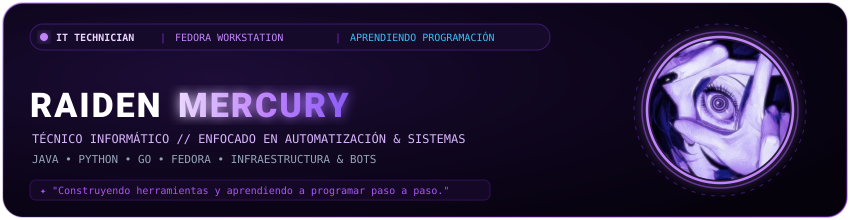
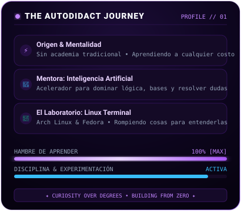
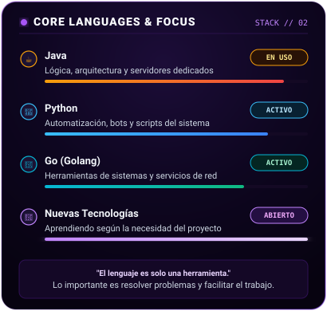

<div align="center">

  <!-- ============================================================== -->
  <!-- 🔮 BANNER SUPERIOR: HEADER ARTÍSTICO                           -->
  <!-- ============================================================== -->
  <a href="https://github.com/RaidenMercury">
    
  </a>

  <br/><br/>

  <!-- ============================================================== -->
  <!-- ⚡ TERMINAL FLOTANTE & CONSOLA EN MOVIMIENTO                   -->
  <!-- ============================================================== -->
  <p align="center">
    
  </p>

  <br/>

  <!-- ============================================================== -->
  <!-- 📊 DASHBOARD: SPECS TÉCNICAS + LENGUAJES EN TIEMPO REAL        -->
  <!-- ============================================================== -->
  <p align="center">
    
    
  </p>

  <br/>

  <!-- ============================================================== -->
  <!-- 📈 ESTADÍSTICAS GLOBALES DE GITHUB (APILADAS Y CENTRADAS)        -->
  <!-- ============================================================== -->
  <p align="center">
    
  </p>

  <p align="center">
    
  </p>

</div>

<br/>

<!-- =================================================================== -->
<!-- 💻 SECCIÓN: SOBRE MÍ & ENFOQUE PRÁCTICO                             -->
<!-- =================================================================== -->
### 🔮 `[ CONSOLA // PERFIL TÉCNICO ]`

```yaml
Perfil: RaidenMercury
Área: Soporte Técnico, Redes & Automatización de Sistemas
Entorno diario: Fedora Linux Workstation
Lenguajes de trabajo: Java, Python & Go
Objetivo: Diseñar software práctico que agilice tareas y optimice infraestructura
```

> *Técnico informático con fuerte atracción por el hardware, las redes y la infraestructura. Cuando una tecnología me atrapa, me adentro de lleno en ella hasta entender cómo se comunican todas sus piezas por dentro.*
>
> *No busco escribir código por escribir: mi meta con la programación es construir herramientas prácticas que resuelvan necesidades reales. Desde automatizar flujos del sistema y crear bots de administración, hasta diseñar arquitecturas de servidores dedicados en Java y utilidades de red en Go.*
>
> *Uso Fedora en mi día a día por su equilibrio entre modernidad y estabilidad sin fricciones, apoyándome en la Inteligencia Artificial como un recurso ágil para profundizar en la teoría, desglosar conceptos complejos y acelerar la resolución de problemas.*

---

### 🛡️ `[ ARSENAL & TECNOLOGÍAS ]`

<div align="center">

  <!-- Lenguajes Principales -->
  
  
  
  
  

  <br/><br/>

  <!-- Entorno & Herramientas -->
  
  
  
  
  

</div>

---

### 📂 `[ PROYECTOS & ÁREAS DE PRÁCTICA ]`

- ☕ **Servidores Dedicados & Plugins (`Java`)**: Arquitectura de servidores de Minecraft (Paper/Purpur 1.21+), desarrollo de plugins modulares, gestión de eventos y mecánicas personalizadas.
- 🤖 **Bots & Herramientas de Comunidad (`Python`)**: Desarrollo de bots de administración, integración de APIs y automatización de procesos para servidores de Discord.
- 🌐 **Herramientas de Red & CLI (`Go`)**: Escaneo, descubrimiento de servicios en red local y monitoreo ligero de infraestructura.
- 💻 **Configuración & Entorno (`Fedora Linux`)**: Administración del sistema, optimización de flujos de trabajo en terminal y creación de scripts en Bash.

---

### 📬 `[ CONTACTO ]`

<div align="center">
  <a href="https://github.com/RaidenMercury">
    
  </a>
  <a href="https://discord.com/users/846354655679873035">
    
  </a>
</div>

<br/>

<div align="center">
  <sub>✦ RaidenMercury • Aprendiendo sin límites ✦</sub>
</div>
