<picture><source media="(prefers-color-scheme: dark)" srcset="assets/top-card-dark.svg"></picture>

<a href="https://github.com/RaidenMercury/ghostty-launcher"><picture><source media="(prefers-color-scheme: dark)" srcset="assets/project-ghostty-launcher-dark.svg"></picture></a>&nbsp;<a href="https://github.com/RaidenMercury/sre-network-discovery"><picture><source media="(prefers-color-scheme: dark)" srcset="assets/project-sre-network-discovery-dark.svg"></picture></a>

<picture><source media="(prefers-color-scheme: dark)" srcset="assets/bottom-card-dark.svg"></picture>

<picture><source media="(prefers-color-scheme: dark)" srcset="assets/wave-dark.svg"></picture>

<a href="https://github.com/RaidenMercury?tab=repositories"><picture><source media="(prefers-color-scheme: dark)" srcset="assets/button-1-dark.svg"></picture></a>&nbsp;&nbsp;<a href="https://discord.com/users/846354655679873035"><picture><source media="(prefers-color-scheme: dark)" srcset="assets/button-2-dark.svg"></picture></a>

<a href="https://metawka.github.io/expressive-profile/?from=RaidenMercury"><picture><source media="(prefers-color-scheme: dark)" srcset="assets/credit-dark.svg"></picture></a>

