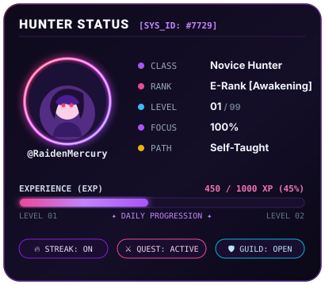
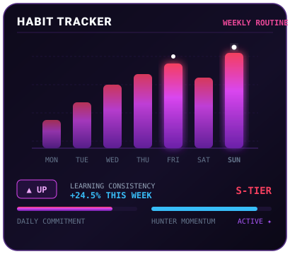
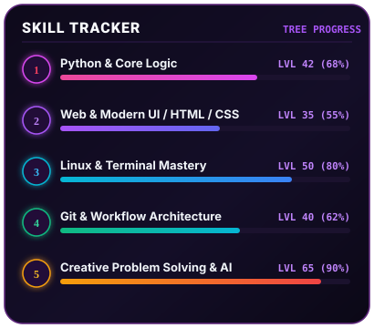
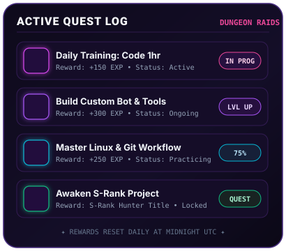
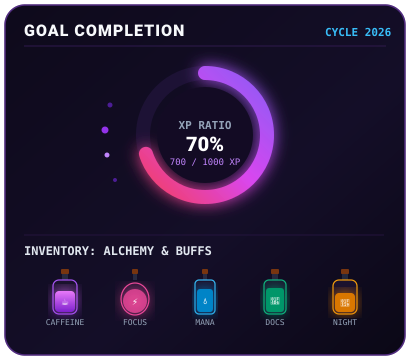

<div align="center">

  <!-- ============================================================== -->
  <!-- 🔮 HEADER: SOLO LEVELING SYSTEM BANNER                           -->
  <!-- ============================================================== -->
  <a href="https://github.com/RaidenMercury">
    
  </a>

  <br/><br/>

  <!-- ============================================================== -->
  <!-- ⚡ TEXTO ANIMADO (TYPING EFFECT CON ESTILO NEÓN PÚRPURA)        -->
  <!-- Puedes personalizar las frases en el enlace lines=...          -->
  <!-- ============================================================== -->
  <a href="https://github.com/RaidenMercury">
    
  </a>

  <br/><br/>

  <!-- ============================================================== -->
  <!-- 📊 FILA 1 DEL DASHBOARD: ESTADO DEL JUGADOR + HABIT TRACKER    -->
  <!-- ============================================================== -->
  <p align="center">
    
    
  </p>

  <!-- ============================================================== -->
  <!-- 📊 FILA 2 DEL DASHBOARD: HABILIDADES + MISIONES ACTIVAS         -->
  <!-- ============================================================== -->
  <p align="center">
    
    
  </p>

  <!-- ============================================================== -->
  <!-- 📊 FILA 3 DEL DASHBOARD: XP & POCIONES + ESTADÍSTICAS GITHUB   -->
  <!-- ============================================================== -->
  <p align="center">
    
    
  </p>

  <!-- GitHub Overall Stats -->
  <p align="center">
    
    
  </p>

</div>

<br/>

<!-- =================================================================== -->
<!-- ⚔️ SECCIÓN: SOBRE MÍ / INTRODUCCIÓN DEL CAZADOR                     -->
<!-- 💡 EDITA ESTE TEXTO CON TUS PROPIAS PALABRAS                        -->
<!-- =================================================================== -->
### 🔮 `[ REGISTRO DEL CAZADOR: RAIDEN MERCURY ]`

```yaml
Nombre: RaidenMercury
Clase: Aprendiz de Tecnología / Entusiasta Amateur
Nivel: 01 (En constante evolución)
Mundo actual: Linux, Automatizaciones & Desarrollo
Misión principal: Aprender haciendo, romper cosas y volver a armarlas
Estado de maná: 100% (Potenciado con café ☕)
```

> *"No soy un programador experto, soy un curioso con acceso a una terminal y ganas insaciables de aprender a crear mis propias herramientas."*

---

### 🛡️ `[ ARSENAL & EQUIPAMIENTO (TECH STACK) ]`

<div align="center">

  <!-- Lenguajes & Lógica -->
  
  
  
  
  

  <br/>

  <!-- Entorno & Herramientas -->
  
  
  
  
  
  

</div>

---

### 🌌 `[ MAZMORRAS EXPLORADAS (MIS PROYECTOS) ]`

Aquí puedes ver algunos de los proyectos en los que estoy experimentando y aprendiendo:

- 🤖 **Discord Bots & Automatización**: Creación de bots y scripts interactivos para gestión y entretenimiento.
- 🐧 **Linux & Terminal Tweaks**: Personalización de sistemas, scripts en Bash y exploración de herramientas CLI.
- ⚡ **Experimentos & Aprendizaje Continuo**: Pruebas con APIs, lógica y desarrollo paso a paso.

---

### 📬 `[ CANAL DE CONTACTO / GREMIO ]`

<div align="center">
  <a href="https://github.com/RaidenMercury">
    
  </a>
  <a href="mailto:tu-correo@ejemplo.com">
    
  </a>
  <a href="https://discord.com">
    
  </a>
</div>

<br/>

<div align="center">
  <sub>✦ Sistema diseñado con temática Solo Leveling • Hecho con curiosidad, código y café ✦</sub>
</div>
