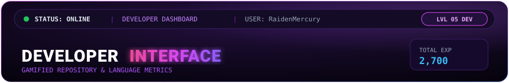
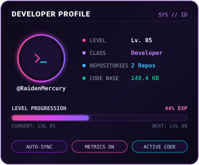
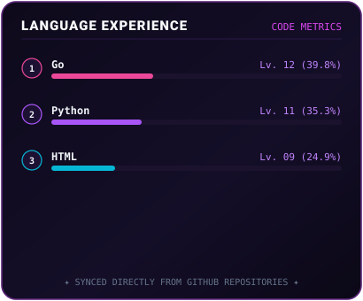
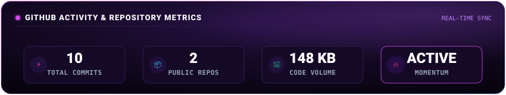

<div align="center">

  <!-- ============================================================== -->
  <!-- 🔮 BANNER SUPERIOR: DEVELOPER INTERFACE                         -->
  <!-- ============================================================== -->
  <a href="https://github.com/RaidenMercury">
    
  </a>

  <br/><br/>

  <!-- ============================================================== -->
  <!-- 📊 FILA 1: PERFIL DE DESARROLLADOR + LENGUAJES Y EXPERIENCIA    -->
  <!-- (Se actualiza automáticamente con tus repositorios)            -->
  <!-- ============================================================== -->
  <p align="center">
    
    
  </p>

  <!-- ============================================================== -->
  <!-- 📈 FILA 2: ESTADÍSTICAS GLOBALES DE GITHUB CENTRADAS           -->
  <!-- (100% simétrico, centrado y con fondo morado difuminado)       -->
  <!-- ============================================================== -->
  <p align="center">
    
  </p>

</div>

<br/>

<!-- =================================================================== -->
<!-- 💻 SECCIÓN: INTRODUCCIÓN Y BIO                                      -->
<!-- =================================================================== -->
### 🔮 `[ DEVELOPER CONSOLE // ABOUT ME ]`

```yaml
Developer: RaidenMercury
Role: Aprendiz en Tecnología / Entusiasta de Código
Enfoque: Linux, Terminal, Automatización & Desarrollo de Software
Objetivo: Crear herramientas prácticas, aprender lógica y entender sistemas
Filosofía: Aprender haciendo, probar, romper y reconstruir
```

> *"Amateur en constante aprendizaje. No busco saberlo todo, sino entender cómo funcionan las cosas y construir herramientas útiles paso a paso."*

---

### 🛡️ `[ ARSENAL & HERRAMIENTAS ]`

<div align="center">

  <!-- Lenguajes & Lógica -->
  
  
  
  
  
  

  <br/><br/>

  <!-- Entorno & Sistemas -->
  
  
  
  
  
  

</div>

---

### 📂 `[ PROYECTOS & EXPLORACIONES DESTACADAS ]`

- 🤖 **Bots & Automatización**: Herramientas y scripts para gestión de servidores, automatización de tareas y experimentos con APIs.
- 🐧 **Entorno Linux & CLI**: Configuración de sistemas, scripts en Bash y herramientas de terminal.
- 🔍 **Redes & Monitoreo**: Proyectos de descubrimiento y exploración de infraestructura y servicios.

---

### 📬 `[ CONECTAR // CONTACTO ]`

<div align="center">
  <a href="https://github.com/RaidenMercury">
    
  </a>
  <a href="mailto:tu-correo@ejemplo.com">
    
  </a>
  <a href="https://discord.com">
    
  </a>
</div>

<br/>

<div align="center">
  <sub>✦ Dashboard Cyberpunk Violeta • Sincronizado automáticamente con GitHub Actions ✦</sub>
</div>
